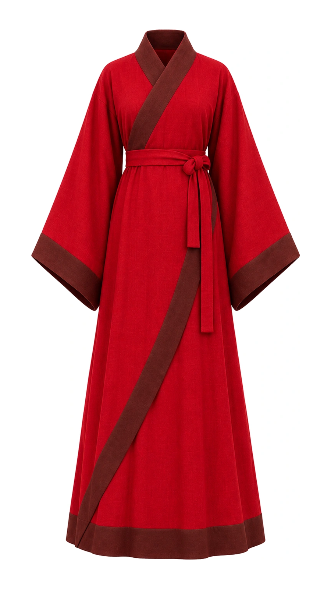
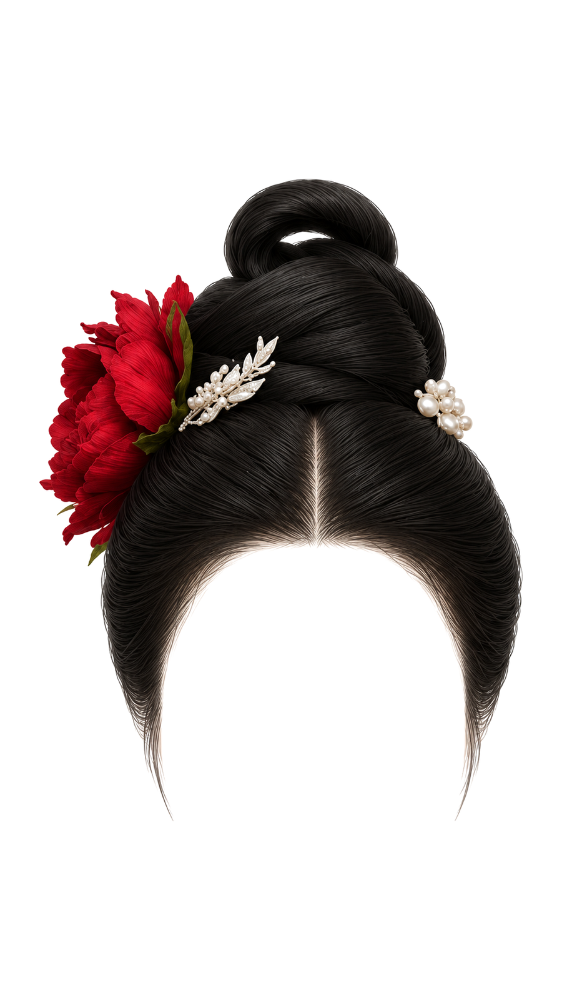
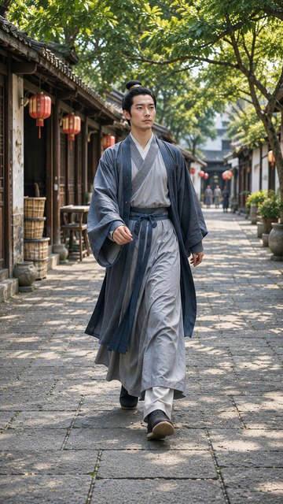

# Form & Attire · A Hanfu Portrait Reference Library

[简体中文](README.md) | **English** | [Live preview](https://hanfu.bange.si/)

An open image library for planning Hanfu portrait shoots, sharing styling ideas, and generating portraits from multiple references. Download a garment, hairstyle, or pose on its own, or use its ID to compare the same subject from several angles. The images are AI-assisted designs. Dynasty and role tags help you find references for creative work. For historical reconstruction, check garment construction and dress conventions against historical sources.

| Clothing · Everyday wraparound robe | Hairstyle · High bun with red floral pins | Sample portrait · Walking naturally |
| :---: | :---: | :---: |
|  |  |  |

## Browse and download

The three public indexes contain **483 sets and 2,322 images**. Find an entry by name or ID, open the image at the listed path in GitHub, and select **Download raw file**. For programmatic downloads, append the indexed path to `https://raw.githubusercontent.com/ban-ge/hanfu-pose/main/`. Replace `main` with a commit hash to pin the file to a specific version.

| Category | Sets | Index | Available views |
| --- | ---: | --- | --- |
| Outer garments | 253 | [Garment index](data/garment-images.json) | Front, three-quarter, side, back |
| Inner garments | 20 | [Garment index](data/garment-images.json) | Front, three-quarter, side, back |
| Hairstyles and headwear | 80 | [Headwear index](data/head-images.json) | Front, three-quarter, side, back |
| Poses | 130 | [Pose index](data/pose-images.json) | Front, three-quarter, side, high angle, low angle, plus a sample portrait |

For garments, hairstyles, and headwear, `views` contains the PNG path for each angle. For poses, `files` contains five JPG views, a full-size sample portrait (`example-full`), and its thumbnail (`example`). Full-size images are 900 × 1600 px. Sample portrait thumbnails are 360 × 640 px. Use the exact paths from the indexes because some directory names include a style suffix.

For example, P001, “Walking naturally,” shows how the same pose translates from a model to a portrait. [Front view](assets/pose/P001-common/front.jpg) · [High-angle view](assets/pose/P001-common/high.jpg) · [Full-size sample portrait](https://raw.githubusercontent.com/ban-ge/hanfu-pose/main/assets/pose/P001-common/example-full.jpg)

## Run the gallery locally

The gallery covers all 483 indexed sets. The clothing tab groups 253 outer garments with 20 inner garments. The catalog provides additional styling notes for individual entries. [Styling catalog](data/catalog.json)

From the repository root, use Node.js 22.12 or later with pnpm to install dependencies and start the Vite 8 development server.

```sh
pnpm install --frozen-lockfile
pnpm dev
```

Open the local URL printed in the terminal. To validate the data and preview a production build, run the following commands. The asset and role checks require Python 3.

```sh
pnpm verify:assets
pnpm verify:coverage
pnpm typecheck
pnpm build
pnpm preview
```

The gallery uses React, TypeScript, HeroUI, and Vite. Indexed images live in `assets/`. The `data/` directory contains the download indexes, catalog, and outfit suggestions by role. The interface lives in `src/`, and `tools/` contains validation and asset preparation scripts.

For maintainers syncing with the local Hanfu image-generation site, start that site first and run `python3 tools/sync_library.py`. The script matches entries by ID, checks the original views, and synchronizes published names and filter metadata. For selection criteria, required angles, and guidance on using local research records, see the [production guide](docs/guides/dynasty-reference-workflow.en.md) and [batch visual review guide](docs/guides/batch-review.en.md).

Further reading: [Asset production and website sync](.agents/skills/hanfu-asset-library/SKILL.en.md) · [Song dynasty reference example](docs/guides/song-character-reference.en.md) · [Gallery architecture](docs/ARCHITECTURE.en.md)

## Generate a portrait with your own API

1. Choose a pose and a garment (outer or inner), then open the composition workbench (**组合工作台**). You can also choose one hairstyle or headpiece. Selecting another reference in the same category replaces the previous one.
2. Describe the person and scene, then review the assembled prompt.
3. Configure your image service in the workbench and select **生成人物图** (Generate portrait). When the request finishes, you can preview and download the result.

| Setting | Example or value |
| --- | --- |
| `BASE_URL` | `https://api.openai.com/v1` for OpenAI |
| Model | `gpt-image-2`, or a 2.5 or 2.6 Flare or Sunburst model supported by your provider |
| `API_KEY` | Your own API key with access to the selected model |

The browser sends the original references to `POST /images/edits` as repeated `image[]` fields in the order used by the prompt. The request uses your selected model, aspect ratio, resolution, and quality. GPT Image 2 defaults to 9:16 at 1K (864 × 1536 px). Your provider must support the selected model and output size, the image edits endpoint, and cross-origin requests from the browser. The provider bills each request.

Select **保存本地配置** (Save local configuration) to reuse the service address, model, and API key in the same browser at the same site address. You can edit or clear the saved settings. On a shared device, you can enter the settings and generate a portrait without saving them.

## Licensing and attribution

- **Original images** in `assets/` may be shared and adapted, including for commercial use. Credit the creator, link to the source and license, and indicate any changes you made. [CC BY 4.0](LICENSE-images)
- **Project code** is available under the MIT License. Retain the copyright and permission notices when redistributing it. [MIT License](LICENSE)
- Third-party historical materials and film or television references belong to their respective rights holders. Production stills are used only for local research.

Example attribution for a cropped image:

> “Walking naturally” (P001), from *Form & Attire* by ban-ge. Cropped from the original. [Source](https://github.com/ban-ge/hanfu-pose) · [CC BY 4.0](https://creativecommons.org/licenses/by/4.0/)

The gallery’s category navigation and download instructions draw on [AI Pose Gallery (Chinese edition)](https://github.com/ban-ge/ai-pose-gallery-zh) and [Shisei](https://github.com/wquguru/shisei).
